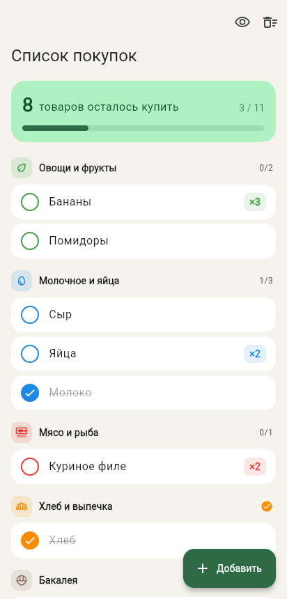
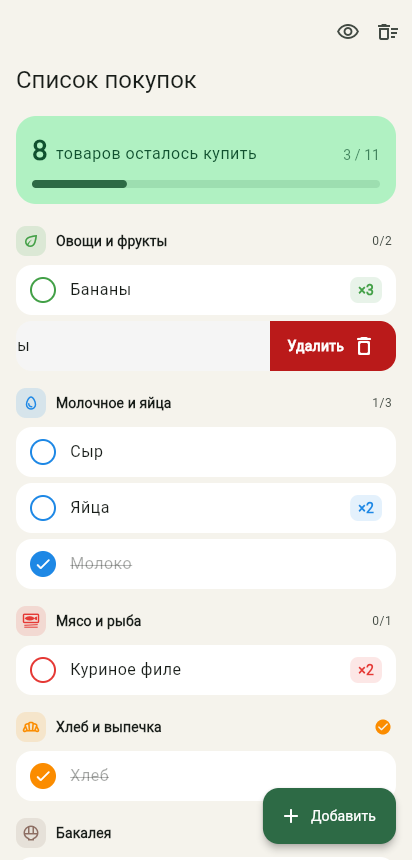
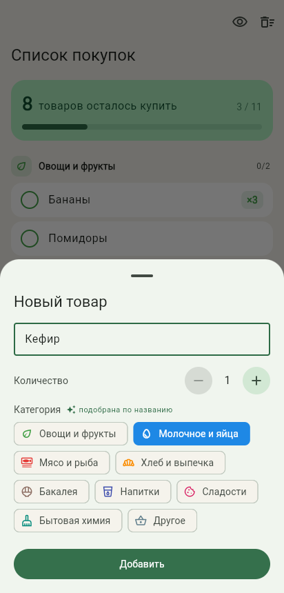

# Список покупок

Список покупок на Flutter: товары сгруппированы по отделам магазина, купленные
отмечаются тапом или свайпом, удаляются свайпом с возможностью отмены. Всё
хранится локально в Hive. Работает на Android, Windows и в браузере.

| Список | Свайп влево | Добавление |
| --- | --- | --- |
|  |  |  |

## Что внутри

| Тема | Где смотреть |
| --- | --- |
| **CRUD** | `lib/data/shopping_repository.dart`: `add`, `save` (изменение и отмена удаления), `toggleBought`, `delete`, `clearBought` / `restoreAll`. Виджеты не обращаются к Hive напрямую. |
| **Локальная база (Hive CE)** | Две коробки: `shopping_items` (товары) и `settings` (флаг «скрыть купленные»). Адаптер `lib/models/shopping_item_adapter.dart` написан вручную, без `build_runner`. Поля пишутся парами «номер, значение», поэтому новые поля можно добавлять без миграции. На вебе данные лежат в IndexedDB. |
| **Жесты** | `lib/widgets/item_tile.dart`: `Dismissible` с разными действиями в две стороны. Вправо отмечает «куплено», и строка возвращается на место (`confirmDismiss` возвращает `false`). Влево удаляет, в SnackBar есть «Отменить». Тап тоже отмечает, долгое нажатие открывает редактирование. |
| **Категории** | `lib/models/item_category.dart`: 9 отделов со своими цветом и иконкой. Заголовки «прилипают» при прокрутке (`SliverMainAxisGroup` + `PinnedHeaderSliver`). При вводе названия категория подбирается сама («Кефир» → «Молочное и яйца»), пока её не выбрали вручную. |
| **Реактивность** | `ListenableBuilder` слушает обе коробки сразу (`Listenable.merge`), так что любое изменение в базе сразу видно на экране. |

## Управление

- **Тап / свайп вправо**: куплено ↔ не куплено
- **Свайп влево**: удалить (можно отменить)
- **Долгое нажатие**: изменить название, количество, категорию
- 👁 в шапке: скрыть / показать купленные
- 🗑 в шапке: удалить все купленные (с подтверждением и отменой)

## Запуск

```sh
flutter pub get
flutter run -d chrome      # или windows / android-устройство
flutter test               # 25 тестов: репозиторий, адаптер, группировка, жесты в UI
```

Тесты работают с настоящим Hive: репозиторий и виджеты проверяются на коробках
в памяти (`Hive.openBox(..., bytes: ...)`), адаптер на коробке во временной
папке (запись, закрытие, повторное открытие).
